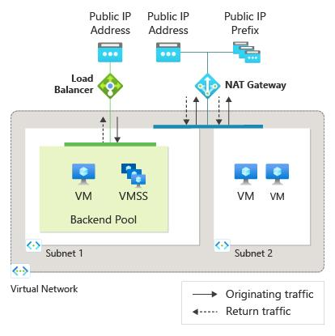

# **Azure VMSS Autoscaling Infrastructure — Resource Documentation**

This project deploys a containerized Node.js application on Azure Virtual Machine Scale Sets (VMSS), behind an Azure Load Balancer, with outbound internet connectivity provided by a NAT Gateway. The infrastructure is provisioned using Terraform with a modular architecture.

The goal is to demonstrate a production-style cloud architecture, infrastructure as code, high availability, network segmentation, load balancing, and automatic scaling.

## **1. Architecture overview**

The application runs on Linux VM Scale Set instances in a private subnet. Inbound
TCP port 80 traffic enters through the Load Balancer and is sent to healthy
instances in its backend pool. Outbound internet traffic from the subnet uses
the NAT Gateway. The VMSS custom-data script installs Docker and starts the
application container, while Azure Monitor autoscaling adjusts the instance
count based on average CPU usage.

### Architecture diagrams

[](documentation/diagrams/diagram2.jpg)

*Figure 1. Reference topology for the VMSS, Load Balancer, and NAT Gateway.
Select the image to open it at full size.*

Additional network topology references can be found at the diagrams folder [diagrams folder](documentation/diagrams/).


The infrastructure is organized into Terraform modules, each responsible for a particular part of the Azure architecture.


- **Inbound traffic:** Users access the application through the Load Balancer's public IP.
- **Load distribution:** Azure distributes requests across healthy VMSS instances.
- **Outbound traffic:** VMSS instances access the internet through the NAT Gateway.
- **Scaling:** VMSS capacity can increase or decrease automatically based on workload demand.

## **2. Azure resources and their purpose**

### **Networking module**

Module: `modules/networking/`

| Azure resource               | Terraform resource                                  | Purpose                                                                          |
| ---------------------------- | --------------------------------------------------- | -------------------------------------------------------------------------------- |
| Resource Group               | `azurerm_resource_group`                            | Logical container for all project resources.                                     |
| Virtual Network (VNet)       | `azurerm_virtual_network`                           | Provides an isolated private network for Azure resources.                        |
| Subnet                       | `azurerm_subnet`                                    | Defines the network segment where VMSS instances are deployed.                   |
| Network Security Group (NSG) | `azurerm_network_security_group`                    | Controls inbound and outbound network traffic through security rules.            |
| NSG Rules                    | `azurerm_network_security_rule`                     | Allow or deny specific traffic based on protocol, port, source, and destination. |
| Subnet-NSG Association       | `azurerm_subnet_network_security_group_association` | Applies the NSG's security policy to the subnet.                                 |

**Why these resources are needed:**

They establish the foundation of the cloud infrastructure. The VNet and subnet provide network connectivity, while the NSG controls access to the deployed workloads.

### **NAT Gateway module**

Module: `modules/nat-gateway/`

| Azure resource     | Terraform resource                          | Purpose                                                                   |
| ------------------ | ------------------------------------------- | ------------------------------------------------------------------------- |
| NAT Public IP      | `azurerm_public_ip`                         | Provides a public IP address for outbound internet connections.           |
| NAT Gateway        | `azurerm_nat_gateway`                       | Enables reliable outbound internet connectivity for private VM instances. |
| NAT IP Association | `azurerm_nat_gateway_public_ip_association` | Connects the public IP to the NAT Gateway.                                |
| Subnet Association | `azurerm_subnet_nat_gateway_association`    | Attaches the NAT Gateway to the VMSS subnet.                              |

**Why we use a NAT Gateway:**

VMSS instances need outbound internet access to:

- Download operating system packages.
- Install Docker.
- Pull the application image from Docker Hub.
- Access external services when required.

The NAT Gateway allows outbound connectivity without assigning public IP addresses directly to individual VMs.

It also provides a centralized outbound IP address for the subnet.

### **Load Balancer module**

Module: `modules/load-balancer/`

| Azure resource            | Terraform resource                | Purpose                                                             |
| ------------------------- | --------------------------------- | ------------------------------------------------------------------- |
| LB Public IP              | `azurerm_public_ip`               | Provides the public entry point for incoming application traffic.   |
| Azure Load Balancer       | `azurerm_lb`                      | Distributes incoming connections across backend VM instances.       |
| Frontend IP Configuration | Within `azurerm_lb`               | Connects the Load Balancer to its public IP.                        |
| Backend Pool              | `azurerm_lb_backend_address_pool` | Defines the group of VM instances receiving traffic.                |
| Health Probe              | `azurerm_lb_probe`                | Checks whether backend instances are healthy.                       |
| Load Balancing Rule       | `azurerm_lb_rule`                 | Defines how frontend traffic is forwarded to the backend instances. |
| Inbound NAT Rules (SSH)   | `azurerm_lb_nat_rule`             | Optionally enables individual VM SSH access through mapped ports.   |

**Why we use a Load Balancer:**

Instead of users connecting directly to individual VMs, they access one public IP address.

The Load Balancer:

- Distributes traffic across VM instances.
- Uses health probes to identify healthy backends.
- Avoids sending traffic to unhealthy instances.
- Provides a single entry point to the application.

### **VM Scale Set module**

Module: `modules/vmss/`

| Azure resource / component | Terraform resource / file                 | Purpose                                                          |
| -------------------------- | ----------------------------------------- | ---------------------------------------------------------------- |
| Linux VM Scale Set         | `azurerm_linux_virtual_machine_scale_set` | Creates and manages a group of identical Linux virtual machines. |
| VMSS instances             | Managed by VMSS                           | Run application containers and provide compute capacity.         |
| VMSS network interface     | Embedded VMSS configuration               | Connects instances to the subnet and backend pool.               |
| VMSS OS image              | Embedded VMSS configuration               | Specifies the Linux image used to provision instances.           |
| SSH authentication         | `admin_ssh_public_key`                    | Enables secure administrator access using SSH keys.              |
| Custom Data                | `cloud-init.sh`                           | Automates first-boot provisioning of the instances.              |
| Docker                     | Installed through Custom Data             | Provides the container runtime.                                  |
| Application container      | Docker image                              | Runs the Node.js autoscaling demonstration application.          |

**Why we use a VM Scale Set:**

A VMSS manages multiple identical VMs as a single logical compute resource. Instead of provisioning and configuring each VM manually, we define the desired configuration once.

VMSS provides:

- Consistent instance configuration.
- Centralized instance management.
- Flexible instance capacity.
- Integration with Azure Load Balancer.
- Support for autoscaling.
- Replacement and recovery of instances.

**Custom Data —&#x20;**`cloud-init.sh`

The VMSS Custom Data script automates the initialization process when a VM instance is provisioned.

Our script is intended to:

1. Update the package index.
2. Install required packages.
3. Install and start Docker.
4. Pull the application image.
5. Run the container.
6. Configure the container to restart automatically.

This eliminates manual installation and configuration of Docker on every VM.

### **Autoscaling module**

Module: `modules/autoscaling/` 

| Azure resource    | Terraform resource                  | Purpose                                          |
| ----------------- | ----------------------------------- | ------------------------------------------------ |
| Autoscale Setting | `azurerm_monitor_autoscale_setting` | Defines scaling behavior for the VMSS.           |
| Autoscale Profile | Inside the autoscale setting        | Specifies minimum, default and maximum capacity. |
| Scale-out Rule    | Metric-based rule                   | Adds VM instances when CPU usage is high.        |
| Scale-in Rule     | Metric-based rule                   | Removes VM instances when CPU usage is low.      |

**Planned scaling configuration:**

| Parameter         | Value                |
| ----------------- | -------------------- |
| Minimum instances | 2                    |
| Default instances | 2                    |
| Maximum instances | 5                    |
| Scale out         | CPU greater than 70% |
| Scale in          | CPU below 30%        |
| Cooldown          | To be configured     |

**Why we use autoscaling:**

Autoscaling adjusts compute capacity according to workload demand.

- High demand → add VM instances.
- Low demand → remove VM instances.
- Minimum capacity → maintains availability.
- Maximum capacity → controls resource growth and cost.

The goal is to demonstrate elasticity: the infrastructure responds to workload changes without requiring manual VM provisioning.


### **SSH key pair**

| File                 | Purpose                                                             |
| -------------------- | ------------------------------------------------------------------- |
| `azure_vmss_dev`     | Private key used by the administrator to authenticate to Linux VMs. |
| `azure_vmss_dev.pub` | Public key provided to Azure during VMSS provisioning.              |

The private key stays on your local machine. Terraform passes the public key to Azure to configure SSH access.

## **3. Infrastructure deployment order**

Although Terraform automatically resolves dependencies, the logical deployment sequence is:

### **Phase 1 — Network foundation**

1. Resource Group
2. Virtual Network
3. NSG and security rules
4. Subnet
5. NSG association
   ### **Phase 2 — Connectivity**
6. NAT Public IP
7. NAT Gateway
8. NAT Public IP association
9. NAT Gateway–Subnet association
   ### **Phase 3 — Inbound traffic**
10. Load Balancer Public IP
11. Load Balancer
12. Backend Pool
13. Health Probe
14. Load Balancing Rule
    ### **Phase 4 — Compute**
15. VM Scale Set
16. VMSS instances provisioned
17. Custom Data execution
18. Docker and application deployment
    ### **Phase 5 — Elasticity**
19. Autoscale Setting
20. Scale-out and scale-in rules
21. Autoscale Profile

## **4. Expected traffic flow**

Inbound application request

```
Client / Browser
      │
      ▼
Load Balancer Public IP
      │
      ▼
Azure Load Balancer
      │
      ├──► VMSS Instance 1 ──► Docker ──► Node.js App
      │
      └──► VMSS Instance 2 ──► Docker ──► Node.js App
```

Outbound internet request

```
VMSS Instance
      │
      ▼
Subnet
      │
      ▼
NAT Gateway
      │
      ▼
NAT Public IP
      │
      ▼
Internet
```

## **5. Deployment steps**
The detailed deployment step is outlined at: [deployment steps](documentation/deployment-steps.md)

## **6. Deployment Screenshots**

Deployment and autoscaling screenshots are available in the
[screenshots folder](documentation/screenshots/).

## **7. Key learning objectives**

This project demonstrates practical Azure cloud engineering skills:

- **Infrastructure as Code:** Provisioning and managing Azure resources using Terraform.
- **Modular architecture:** Reusable Terraform modules with clear responsibilities.
- **Networking:** VNet, subnets, NSGs, inbound and outbound traffic management.
- **Compute:** Azure VM Scale Sets and Linux provisioning.
- **Containerization:** Running a Node.js application using Docker.
- **Load balancing:** Distributing application traffic across instances.
- **High availability:** Health probes and multiple application instances.
- **Elasticity:** Automatically adjusting compute capacity based on CPU demand.
- **Security:** SSH public-key authentication and controlled network access.
- **Cost management:** Scaling down capacity when demand decreases and limiting maximum instances.

